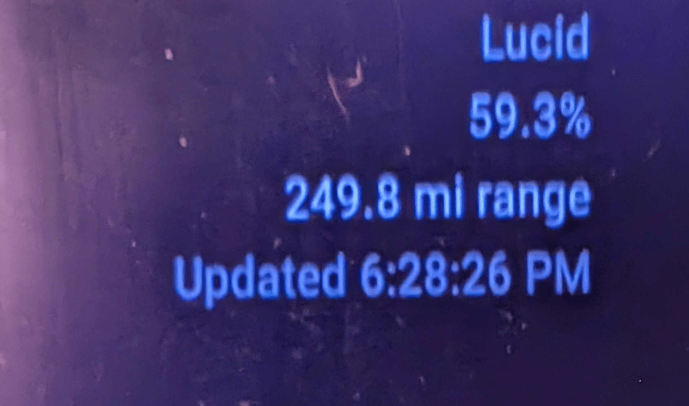

MMM-Lucidinator
===============

MMM-Lucidinator is a module for MagicMirror² that displays battery charge
information for a Lucid vehicle. It uses the unofficial python-lucidmotors
Python library to retrieve vehicle data.

Displayed information:
- Battery charge percentage
- Estimated remaining range
- Battery health (optional)
- Last update time

## screenshot

Installation
============

1. Go to the MagicMirror modules directory and clone this module:

   cd ~/MagicMirror/modules
   git clone <your-repository-url> MMM-Lucidinator
   cd MMM-Lucidinator

2. Install Python's virtual environment support if it is not already installed:

   sudo apt update
   sudo apt install python3-venv

3. Create a virtual environment and install the Lucid client library:

   python3.12 -m venv .venv
   .venv/bin/python -m pip install --upgrade pip
   .venv/bin/python -m pip install -r requirements.txt

   The Lucid client requires Python 3.12 or newer. If your system's default
   Python is older, install Python 3.12 and use python3.12 to create the
   virtual environment.

4. Set the Lucid account credentials in the environment used to start
   MagicMirror. For example, when starting MagicMirror from a terminal:

   export LUCID_EMAIL="your-lucid-account-email"
   export LUCID_PASSWORD="your-lucid-account-password"
   npm start

   Do not commit credentials to this module's repository.

5. If MagicMirror is managed by PM2, make sure the PM2 process receives
   LUCID_EMAIL and LUCID_PASSWORD. After changing environment variables,
   restart the process with updated environment:

   pm2 restart mm --update-env

   Replace "mm" with the MagicMirror process name shown by:

   pm2 list

   For persistent PM2 configuration, define the variables in the PM2
   ecosystem file and protect that file because it contains credentials.

Update
======

Go to the module directory and pull the latest changes:

   cd ~/MagicMirror/modules/MMM-Lucidinator
   git pull

If the Python dependencies have changed, update them in the virtual
environment:

   .venv/bin/python -m pip install -r requirements.txt

Restart MagicMirror after updating the module.

Configuration
=============

Add the following object to the modules array in MagicMirror's
config/config.js:

   {
     module: "MMM-Lucidinator",
     position: "top_right",
     config: {
       pythonExecutable:
         "/home/YOUR_USERNAME/MagicMirror/modules/MMM-Lucidinator/.venv/bin/python",
       scriptPath: "lucid_status.py",
       updateInterval: 300000,
       vehicleIndex: 0,
       rangeUnit: "mi",
       showHealth: false,
       title: "Lucid"
     }
   },

Replace YOUR_USERNAME with the Linux username that runs MagicMirror.
The configured Python path must point to the virtual environment created
during installation.

Configuration options
---------------------

Option             Possible values       Default      Description
-----------------  --------------------  -----------  --------------------
pythonExecutable   Python executable     python3      Python executable
                                                    used by the module.
                                                    Set this to the full
                                                    path of the virtual
                                                    environment's Python.

scriptPath         Relative file path    lucid_status.py
                                                    Python script, relative
                                                    to this module folder.

updateInterval     Milliseconds          300000       How often to fetch
                                                    vehicle status. The
                                                    module enforces a
                                                    minimum interval of
                                                    60000 milliseconds.

vehicleIndex       Integer               0            Which vehicle to
                                                    display, starting
                                                    with 0.

rangeUnit          "mi" or "km"          "mi"         Unit used for
                                                    estimated range.

showHealth         true or false         false        Whether to display
                                                    battery health when
                                                    provided by the API.

title              String                "Lucid"      Heading displayed
                                                    above the vehicle
                                                    information.

Testing
=======

Before starting MagicMirror, test the Python script directly:

   cd ~/MagicMirror/modules/MMM-Lucidinator
   LUCID_EMAIL="your-lucid-account-email" \
   LUCID_PASSWORD="your-lucid-account-password" \
   .venv/bin/python lucid_status.py --range-unit mi

A successful request prints a JSON object containing the battery status.
If the request fails, check the credentials, Python version, installed
dependencies, and the MagicMirror/PM2 logs.

Notes
=====

This module relies on an unofficial Lucid API client. API behavior and
returned vehicle data may change. Keep the python-lucidmotors library
updated and verify that the test command works before relying on the
displayed values.

The module uses the selected vehicle's index in the list returned by the
API. If your account has multiple vehicles, change vehicleIndex to select
another one.

License
=======

Add the license and copyright information that applies to your module
before publishing it.

Changelog
=========

Record notable module changes here.
